<p align="center">
  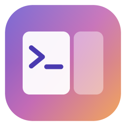
</p>

<h1 align="center">Windex</h1>

<p align="center">
  A native Windows client for <a href="https://www.superlogical.com/rex">Rex</a>, the terminal multiplexer from Superlogical.<br>
  Unofficial, unaffiliated, and built for fun.
</p>

---

I built Windex while I was waiting to get access to the official Rex client for Windows. I also
wanted something that felt properly native on Windows, with Mica, rounded corners and all the
Fluent bits, and it was a good excuse to dig into how the Rex protocol actually works.

> [!IMPORTANT]
> **If you've got access, use the real Rex for Windows.** It's in alpha, it's the official one,
> and it's going to get way more love than this. Otherwise, feel free to use Windex, fork it, and
> add your own features.

<p align="center">
  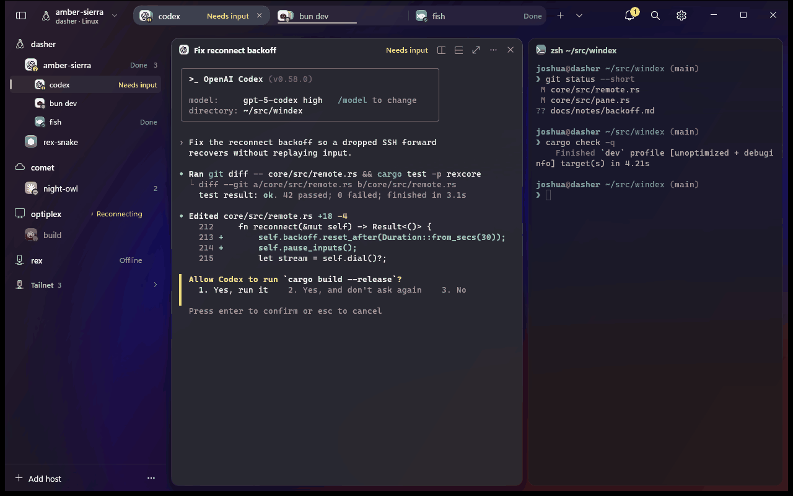
</p>

## What it does

- Connects to your Rex servers over **SSH** or **HTTPS**, and finds the machines on your **tailnet** for you.
- Tabs, splits, zoom and sessions all come from the server, so it stays in sync with Rex on your other machines.
- Terminal emulation is **libghostty**, the same engine Rex and Ghostty use. Windex just draws the cells.
- **Drag files onto a pane** or paste a screenshot to upload it. The path gets typed at the prompt, which is great for Claude Code and Codex.
- Find in scrollback, a command palette, a session switcher and the usual keyboard shortcuts.
- Program icons, "Needs input" and "Done" badges, taskbar progress and Windows notifications.
- Dark, light, Mica, Acrylic and a compact pane style.

## A closer look

<table>
  <tr>
    <td width="50%"><b>Jump to any session, or run any command</b><br>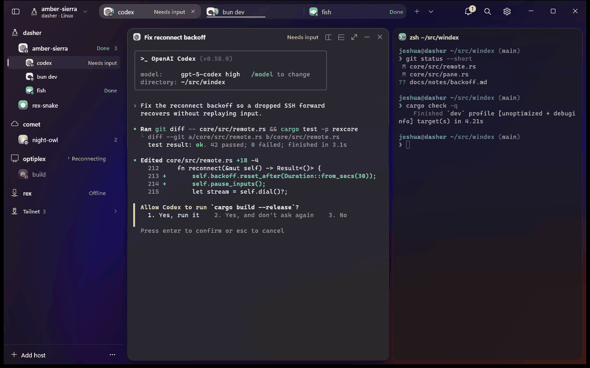</td>
    <td width="50%"><b>Drop files on a pane to upload them</b><br>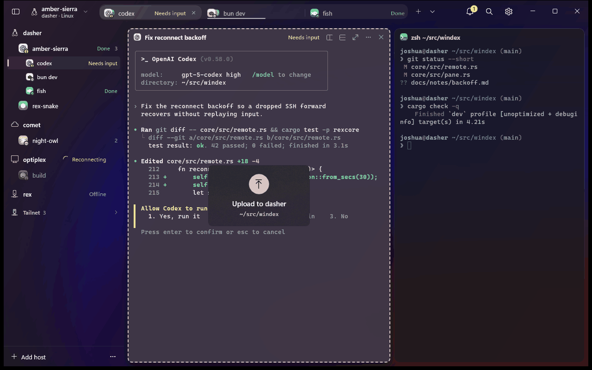</td>
  </tr>
  <tr>
    <td><b>Search the screen and scrollback</b><br></td>
    <td><b>Add a host straight from your tailnet</b><br>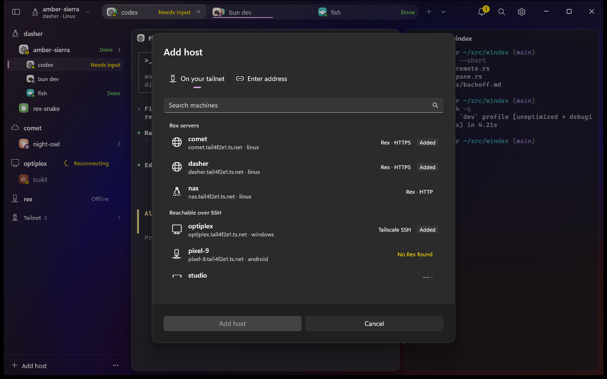</td>
  </tr>
  <tr>
    <td><b>Dark</b><br>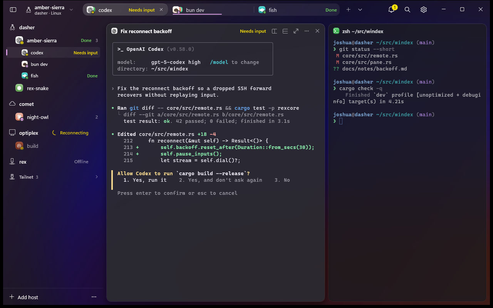</td>
    <td><b>Light</b><br>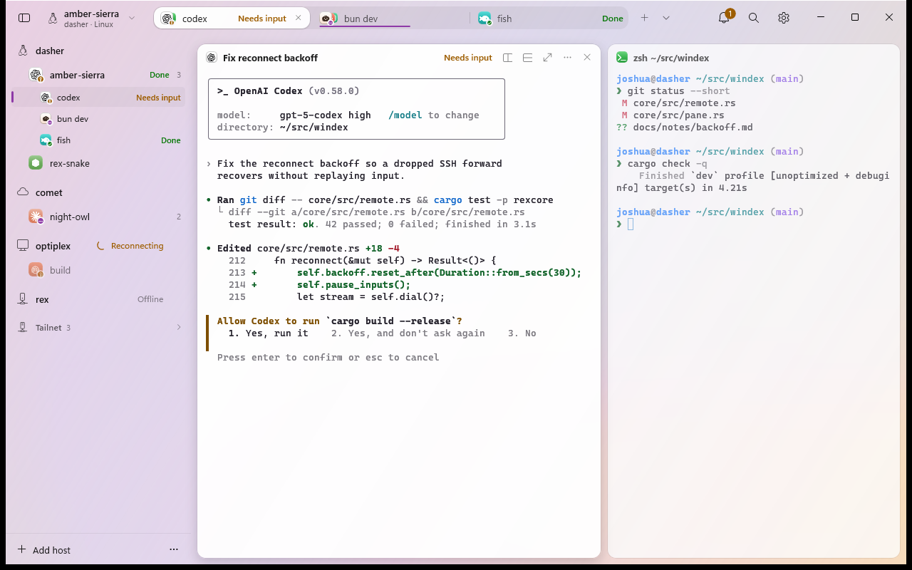</td>
  </tr>
  <tr>
    <td><b>Compact panes</b><br>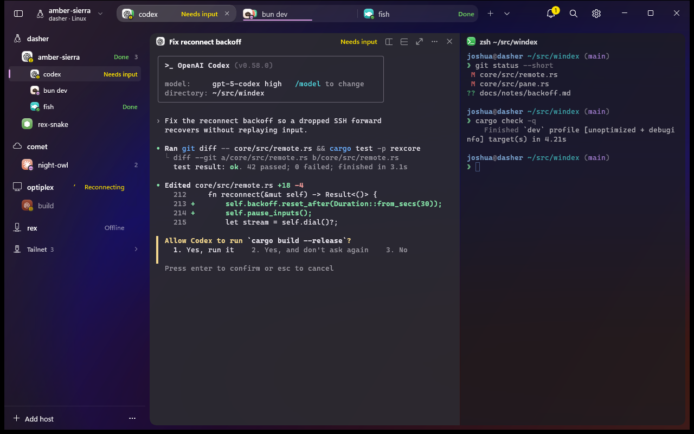</td>
    <td><b>Settings</b><br>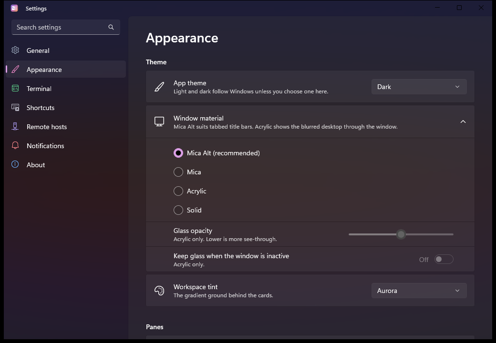</td>
  </tr>
</table>

<sub>These are from the built-in demo mode (<code>--mock</code>), so the servers and sessions are made up.
Point it at a real Rex server and you get your actual sessions.</sub>

## How it works

There are two halves. A Rust core (`rexcore.dll`) owns everything protocol- and terminal-shaped.
The WinUI app owns everything pixel- and input-shaped. They talk through a small C ABI: JSON
commands in, a model of hosts, sessions, tabs and panes out, plus a zero-copy cell buffer for each pane.

<picture>
  <source media="(prefers-color-scheme: dark)" srcset="docs/media/architecture-dark.svg">
  
</picture>

What happens when you open a pane and start typing:

<picture>
  <source media="(prefers-color-scheme: dark)" srcset="docs/media/pane-lifecycle-dark.svg">
  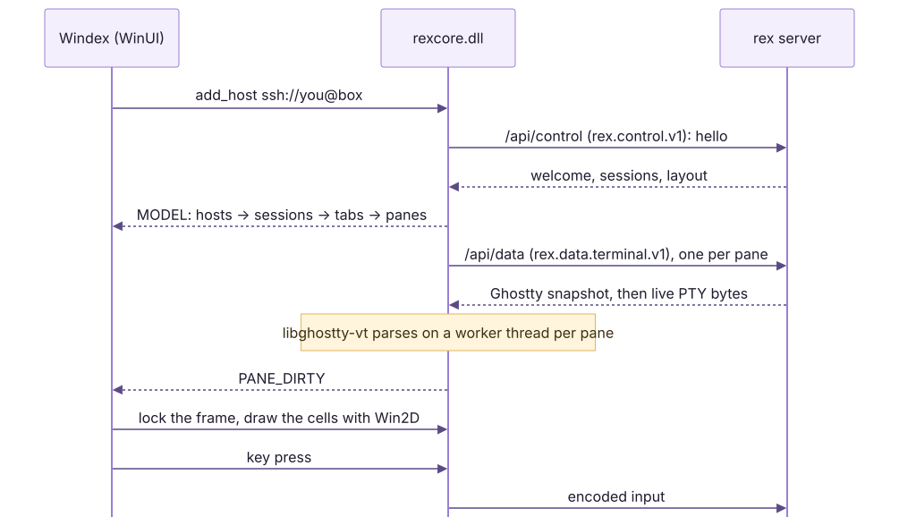
</picture>

## Tech stack

<picture>
  <source media="(prefers-color-scheme: dark)" srcset="docs/media/tech-stack-dark.svg">
  
</picture>

The diagrams are generated from the Mermaid sources in [docs/diagrams](docs/diagrams). If you want the details, I wrote up what I worked out:
[the protocol](docs/protocol.md), [the core ↔ UI contract](docs/contract.md),
[core notes](docs/core-notes.md) and [the design spec](docs/design.md).

## Limitations

- **It's unofficial and reverse-engineered.** I built it against Rex `0.0.179x` (API revision 13), so a Rex update could break it.
- Windows 11 x64 only. There's no installer and nothing is signed, so you build it yourself.
- Only the tiled layout. Floating layers are ignored.
- Rex doesn't authenticate connections, so connect over SSH or your tailnet, never the open internet.
- There's no Jump List or single-instance handling yet, and no "are you sure?" before huge downloads.
- Shortcuts follow Windows Terminal, not the Mac app. If another app grabs one as a global hotkey, Settings → Shortcuts marks it.
- I haven't tested high display scaling (150%+) or high contrast properly.

## Build and run

You need Windows 11, Visual Studio Build Tools (MSVC + Windows SDK), the .NET 10 SDK, Rust
(`rust-toolchain.toml` pins 1.96.1) and Zig 0.17 on your `PATH` for libghostty.

```powershell
. .\scripts\env.ps1          # MSVC environment and toolchain paths
.\scripts\build.ps1 -Core    # rexcore.dll (Rust + libghostty-vt)
.\scripts\build.ps1 -App     # Windex.exe (add -Release for a release build)
.\app\Windex\bin\x64\Debug\net10.0-windows10.0.26100.0\win-x64\Windex.exe
```

Then click **Add host** and pick a machine from your tailnet, or enter `ssh://you@your-box`.
That uses your SSH keys, ssh-agent or Tailscale SSH. Rex needs to be installed on the server.
Add `--mock` to poke around the demo world without a server.

A few shortcuts: <kbd>Ctrl</kbd>+<kbd>Shift</kbd>+<kbd>D</kbd> split right,
<kbd>Alt</kbd>+<kbd>Shift</kbd>+<kbd>-</kbd> split down, <kbd>Ctrl</kbd>+<kbd>Shift</kbd>+<kbd>Z</kbd> zoom,
<kbd>Ctrl</kbd>+<kbd>Shift</kbd>+<kbd>F</kbd> find, <kbd>Ctrl</kbd>+<kbd>Shift</kbd>+<kbd>K</kbd> switch session,
<kbd>Ctrl</kbd>+<kbd>Shift</kbd>+<kbd>P</kbd> command palette. They're all listed in Settings → Shortcuts.

```text
app/Windex        the WinUI 3 app
app/TerminalLab   a test bench for the terminal renderer
core              the Rust core (rexcore.dll), with vendored ghostty-vt and rexrs
docs              protocol notes, the core/UI contract, the design spec
scripts           build, environment and UI test helpers
```

## Credits

- [Rex](https://www.superlogical.com/rex) by Superlogical. Windex isn't affiliated with Superlogical in any way.
- [Ghostty](https://github.com/ghostty-org/ghostty) for libghostty-vt, used through the `ghostty-vt` crate from [prabirshrestha/gpui-cn](https://github.com/prabirshrestha/gpui-cn).
- [rex-rune](https://github.com/shuv1337/rex-rune) by shuv1337, the Linux client I learned a lot from. The vendored crate patches come from there.
- [rexrs](https://github.com/a10y/rexrs) by a10y, for the Rex API types.
- [Symbols Nerd Font](https://github.com/ryanoasis/nerd-fonts) for the icon glyphs in the terminal.

## License

[MIT](LICENSE). The vendored crates in `core/vendor` and the bundled font keep their own licences.
